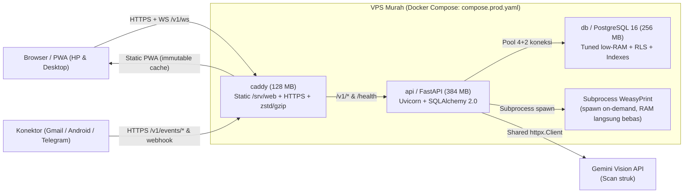
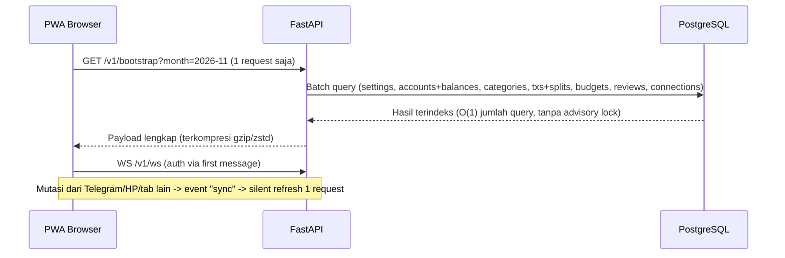

# Arsitektur SamSaku

Dokumen ini menjelaskan struktur kode, alur data utama, dan strategi efisiensi memori/CPU agar SamSaku berjalan cepat dan stabil pada VPS murah (512 MB – 2 GB RAM).

---

## 1. Gambaran Sistem Produksi (3 Container)



### Mengapa 3 Container?
Sebelumnya `compose.prod.yaml` menjalankan 4 container (`db`, `api`, `web` Nginx, `caddy`). Sekarang `web/Dockerfile` memakai multi-stage build (target `caddy`) sehingga hasil static export Next.js (`/web/out`) langsung disajikan oleh `caddy` dari `/srv/web` — menghilangkan overhead container Nginx sepenuhnya.

---

## 2. Struktur Backend (`backend/app/`)

Backend menerapkan arsitektur berlapis (*layered architecture*) agar setiap file pendek, fokus, dan mudah dipelihara:

```text
backend/app/
├── main.py                  # Bootstrap FastAPI, lifespan, GZip, CORS, rate-limit middleware, router
├── core/
│   ├── config.py            # Konstanta timezone Asia/Jakarta, CORS produksi wajib eksplisit & pembacaan env
│   ├── db.py                # Engine SQLAlchemy (pool 4+2), SessionLocal, lock_owner
│   ├── auth.py              # Verifikasi Supabase JWKS JWT & SAMSAKU_DEV_TOKEN
│   ├── rate_limit.py        # SlidingWindowLimiter per IP berbatas memori untuk webhook & kegagalan auth
│   ├── http_client.py       # Shared pooled httpx.Client untuk integrasi eksternal
│   └── realtime.py          # WebSocket hub (/v1/ws) dengan batas koneksi per pemilik/global & cek Origin
├── models/
│   ├── ledger.py            # 14 model buku kas (SQLAlchemy 2.0 Mapped style)
│   └── jobs.py              # FileJob & ImportEntry (SQLAlchemy 2.0 Mapped style)
├── schemas/
│   ├── ledger.py            # Validasi Pydantic untuk dompet, kategori, transaksi, dll.
│   └── tools.py             # Validasi Pydantic untuk impor Excel & konfirmasi struk
├── services/
│   ├── common.py            # Helper fail(), owned(), rows(), columns()
│   ├── calculations.py      # Aturan rupiah(), cycle(), divide()
│   ├── settings.py          # Pengaturan siklus & helper tanggal periode
│   ├── bootstrap.py         # Assembly GET /v1/bootstrap (1 request, zero advisory lock)
│   ├── accounts.py          # Batch balance/reserves/tx_count (3 query total, anti N+1) & CRUD
│   ├── categories.py        # CRUD kategori & validasi hirarki 2 tingkat
│   ├── transactions.py      # Posting double-entry, refund, idempotensi, batch serialize_transactions
│   ├── summary.py           # Summary, pacing siklus, category_deltas & budgets dengan SQL SUM/GROUP BY (tanpa lock_owner)
│   ├── planning.py          # Skema alokasi pos & target tabungan (CRUD + batch query)
│   ├── reviews.py           # Antrean tinjauan, status konektor, dan resolusi idempoten
│   ├── telegram.py          # Bridge webhook Telegram, state machine tombol inline, dan long-polling
│   ├── intake.py            # Redaksi PII, cache parser-rules JSON, ingest bukti
│   ├── imports.py           # Evaluasi savepoint, riwayat impor, & publikasi atomik workbook Excel
│   ├── jobs.py              # Penyimpanan file sementara (DB lokal / Supabase Storage) & tick job
│   ├── ocr.py               # Scan struk & bukti transfer Gemini Vision only (tanpa Tesseract lokal)
│   ├── receipt_matching.py  # Pencocokan nomor rekening/VA (suffix match), klasifikasi transfer/income/expense & redaksi PII
│   ├── receipt_text.py      # Ekstraksi tanggal & inferensi kategori (pengeluaran/pemasukan) berbasis berita/aturan/riwayat
│   ├── reports.py           # CSV & render PDF WeasyPrint di subprocess spawn terisolasi + semaphore tunggal & batas rentang/baris
│   └── xlsx.py              # Parser/generator workbook openpyxl yang aman
└── routers/
    ├── bootstrap.py         # Thin route GET /v1/bootstrap
    ├── accounts.py          # Thin routes /v1/accounts
    ├── categories.py        # Thin routes /v1/categories
    ├── transactions.py      # Thin routes /v1/transactions
    ├── budgets.py           # Thin routes /v1/budgets, /v1/settings & /v1/data/reset
    ├── summary.py           # Thin route /v1/summary
    ├── reviews.py           # Thin routes /v1/reviews, /v1/connections, /v1/events/{source}
    ├── planning.py          # Thin routes /v1/goals & /v1/schemes
    ├── tools.py             # Thin routes /v1/imports/*, /v1/receipts/*, /v1/reports/*, /v1/jobs/tick
    └── telegram.py          # Thin route /v1/webhooks/telegram
```

---

## 3. Struktur Frontend (`web/`)

Frontend dipecah dari file monolitik menjadi modul per fitur, custom hooks, komponen UI bersama, dan CSS modular:

```text
web/
├── app/
│   ├── layout.tsx           # Metadata PWA & font DM Sans saja
│   ├── page.tsx             # Shell utama ringkas (< 320 baris) pengatur state global & navigasi
│   └── globals.css          # Entry import 4 file CSS modular
├── styles/
│   ├── tokens.css           # Variabel warna tema terang/gelap & tipografi
│   ├── base.css             # Reset, layout shell, sidebar, topbar, bottom-nav
│   ├── components.css       # Card, button, modal, form, chip, tx-list
│   └── pages.css            # Dashboard, kalender, statistik, anggaran, pacing, alert banner, laporan, impor, FAB
├── lib/
│   ├── api.ts               # HTTP client + lazy dynamic import ./demo hanya saat sandbox
│   ├── charts.ts            # Agregasi harian/mingguan/kalender & partisi DonutChart bebas refund clamp
│   ├── csv.ts               # Sanitasi sel formula injection CSV klien (identik dengan safe_cell backend)
│   ├── domain.ts            # Tipe data (termasuk Goal, CyclePacing, CategoryDelta) & logika periode/filter
│   ├── format.ts            # Formatter Rupiah, input bertanda, UUID fallback & tanggal terpusat
│   └── demo.ts              # Sandbox interaktif di localStorage (hanya dimuat jika belum login)
├── hooks/
│   ├── useAuth.ts           # Status login Supabase / dev token + registrasi service worker
│   ├── useTheme.ts          # Persistensi tema terang/gelap
│   ├── useLedgerData.ts     # Pemuatan 1x via GET /v1/bootstrap & silent refresh in-place
│   └── useRealtimeSync.ts   # Jittered backoff WebSocket, rekonsiliasi reconnect/online & cooldown 30 detik
├── components/
│   ├── ui/                  # Modal, Field, ErrorNote, CatIcon, WalletIcon, TxList
│   └── layout/              # SidebarNav, Topbar, PageHeader, PageContent, AppDialogs, BottomNav, QuickFab
└── features/
    ├── auth/                # LoginModal
    ├── dashboard/           # DashboardView (alert anggaran, pacing strip, 3-zona), AccountsSection, CategoriesBreakdown
    ├── transactions/        # TransactionsView, EntryForm & submodul (HeaderControls, AmountBox, StandardFields, TransferFields, AdvancedSection, FormFooter, entryPayload, useReceiptAutoFill), CategoryPicker, TransactionDetailModal
    ├── budgets/             # BudgetsView, GoalsPanel (target & amplop tabungan)
    ├── statistics/          # StatisticsView (termasuk category_deltas), DonutChart
    ├── reports/             # ReportsView
    ├── importer/            # ImporterView
    ├── masters/             # MastersView, MasterForm, CategoryEdit
    ├── reviews/             # ReviewsView, ReviewModal, PendingDraftsBanner (1-click approve)
    └── settings/            # SettingsView, DangerZone
```

---

## 4. Alur Data & Strategi Performa



### Poin Efisiensi Utama
1. **7 HTTP request → 1 HTTP request:** `GET /v1/bootstrap` menghilangkan waterfall `/settings` → 6 request paralel dan menghilangkan duplikasi hitung `budgets` & `accounts`.
2. **Zero N+1 Query:** `GET /v1/accounts`, `GET /v1/transactions`, `GET /v1/summary`, `GET /v1/schemes`, dan `GET /v1/bootstrap` semuanya memakai agregasi SQL (`GROUP BY`) dan batch lookup (`IN (...)`) yang dibuktikan lewat `backend/tests/test_performance.py`.
3. **Read-Only Bebas Lock:** `lock_owner` hanya dipakai pada mutasi tulis sehingga permintaan baca tidak saling mengantri.
4. **RAM Terkendali:**
   - Tanpa `tesseract-ocr` (~120 MB+ lebih hemat di image Docker & tidak ada lonjakan CPU/RAM OCR lokal).
   - WeasyPrint PDF dirender di subprocess `spawn` terpisah dengan timeout 30 detik agar memori Pango/Cairo langsung kembali ke sistem operasi.
   - Frontend tidak memuat Tailwind CSS v4 maupun font Instrument Serif yang tidak dipakai, serta melakukan code-splitting (`next/dynamic`) per halaman & modal.
