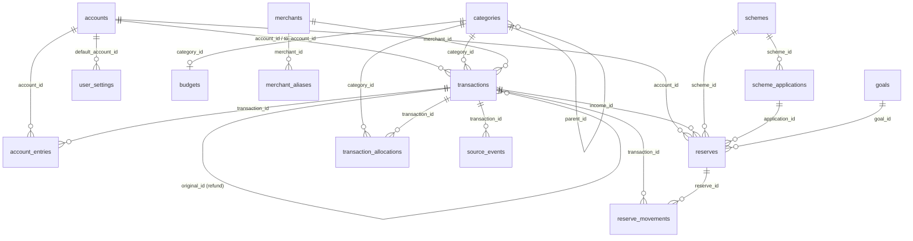

# Skema Database & Index PostgreSQL

SamSaku menggunakan PostgreSQL 16 (dengan SQLite in-memory khusus untuk unit test cepat). Seluruh perubahan skema dikelola secara deterministik melalui Alembic (`backend/alembic/versions/`).

---

## 1. Diagram Relasi Entitas (ERD)

---

## 2. Daftar Tabel Utama

| Tabel | Model ORM | Fungsi | Constraint Unik |
| --- | --- | --- | --- |
| `accounts` | `Account` | Dompet/rekening, identitas opsional (`account_number` non-unik untuk pencocokan bukti transfer), dan titik saldo awal (`opening_date`, `opening_balance`) | `(owner_id, code)` |
| `categories` | `Category` | Kategori pemasukan/pengeluaran (maksimal 2 tingkat via `parent_id`) | `(owner_id, code)` |
| `merchants` | `Merchant` | Master toko/merchant | `(owner_id, code)` |
| `merchant_aliases` | `Alias` | Nama alias merchant saat impor | `(owner_id, name)` |
| `transactions` | `Transaction` | Header transaksi (`income`, `expense`, `transfer`, `refund`) | `(owner_id, source, source_ref)` |
| `account_entries` | `Entry` | Baris mutasi saldo per dompet (`delta` bertanda +/-) | — |
| `transaction_allocations` | `Split` | Rincian nominal pelaporan per kategori atau biaya admin (`role`: `income`/`expense`/`fee`) | — |
| `source_events` | `Evidence` | Bukti mentah (teredaksi) dari Gmail, GoPay, Telegram, dan struk | `(owner_id, source, external_id, digest)` |
| `user_settings` | `UserSettings` | Pengaturan `monthly_start_day`, `weekly_start_day`, `default_account_id` | `(owner_id)` |
| `budgets` | `Budget` | Batas anggaran bulanan per kategori pengeluaran | `(owner_id, category_id)` |
| `goals` | `Goal` | Target tabungan untuk alokasi pos | — |
| `schemes` | `Scheme` | Definisi aturan pembagian pemasukan | `(owner_id, code)` |
| `scheme_applications` | `Allocation` | Snapshot penerapan skema (idempoten via `request_id`) | `(owner_id, request_id)` |
| `reserves` | `Reserve` | Dana tercadang per pos & dompet dari pemasukan tertentu | — |
| `reserve_movements` | `ReserveMovement` | Pemakaian/pengembalian dana cadangan oleh transaksi | — |
| `file_jobs` | `FileJob` | Status pekerjaan sementara unggahan `.xlsx` dan foto struk | — |
| `import_entries` | `ImportEntry` | Jejak asal baris Excel ke record buku kas | `(job_id, sheet, row)` |

---

## 3. Riwayat Migrasi Alembic & Index Performa

| Revisi | File | Deskripsi |
| --- | --- | --- |
| `0001` | `0001_core.py` | Tabel inti buku kas, bukti, skema/cadangan, RLS PostgreSQL, pencabutan akses role publik. |
| `0002` | `0002_tools.py` | Tabel `file_jobs` dan `import_entries` + RLS PostgreSQL. |
| `0003` | `0003_budgets_and_settings.py` | Tabel `user_settings` dan `budgets` + RLS PostgreSQL. |
| `0004` | `0004_performance_indexes.py` | Composite index performa untuk query cepat pada VPS rendah RAM. |
| `0005` | `0005_account_number.py` | Menambahkan kolom opsional `account_number VARCHAR(32)` pada tabel `accounts` untuk deteksi otomatis sumber dana & transfer antar dompet. |

### Index Performa (Migrasi `0004`)
- `ix_transactions_owner_date` pada `transactions (owner_id, date)` — mempercepat filter rentang siklus di `/v1/bootstrap`, `/v1/summary`, `/v1/transactions`.
- `ix_transactions_owner_account` & `ix_transactions_owner_to_account` — mempercepat mutasi & hapus dompet.
- `ix_transactions_original_id` — mempercepat validasi refund.
- `ix_account_entries_owner_account` — mempercepat agregasi saldo & jumlah transaksi semua dompet sekaligus.
- `ix_source_events_owner_status_occurred` — mempercepat antrean `/v1/reviews`.
- `ix_reserves_owner_account` — mempercepat agregasi saldo tercadang per dompet.

---

## 4. Keamanan Database (Row Level Security)

Pada PostgreSQL, setiap tabel memiliki:
- `ALTER TABLE "<name>" ENABLE ROW LEVEL SECURITY`
- `REVOKE ALL ON TABLE "<name>" FROM PUBLIC` (serta role `anon` dan `authenticated` bila tersedia).

Data hanya bisa diakses melalui backend FastAPI yang memverifikasi identitas pemilik dan memfilter semua query berdasarkan `owner_id`.
